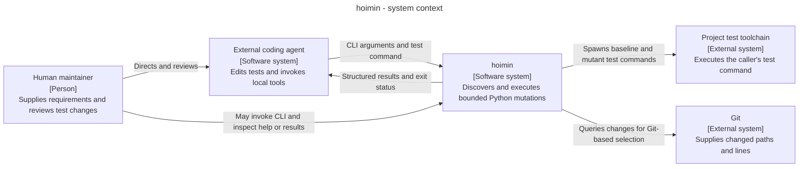
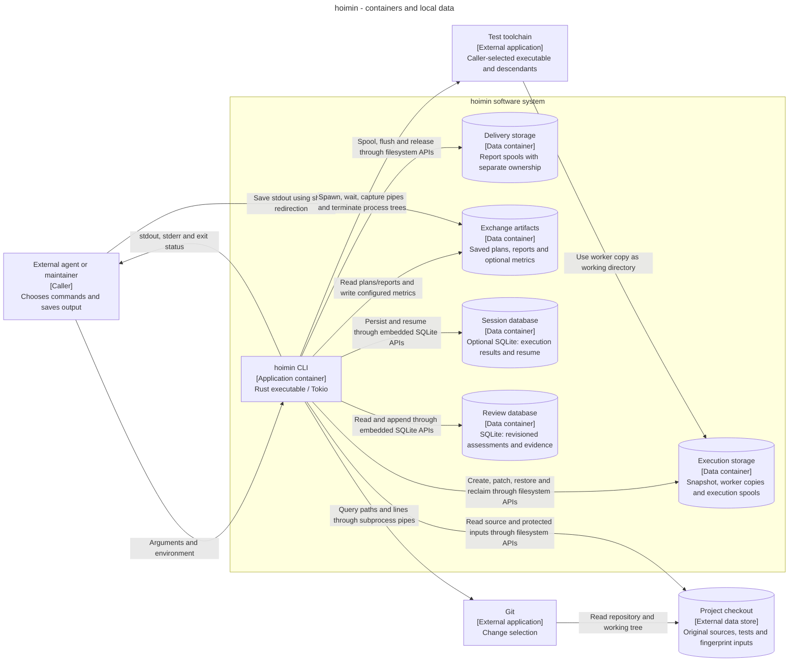
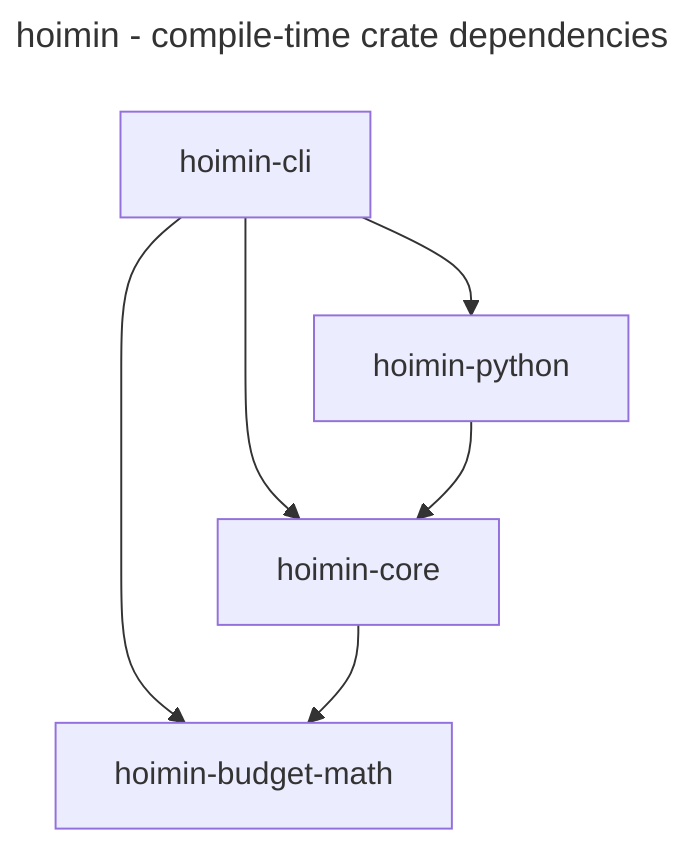
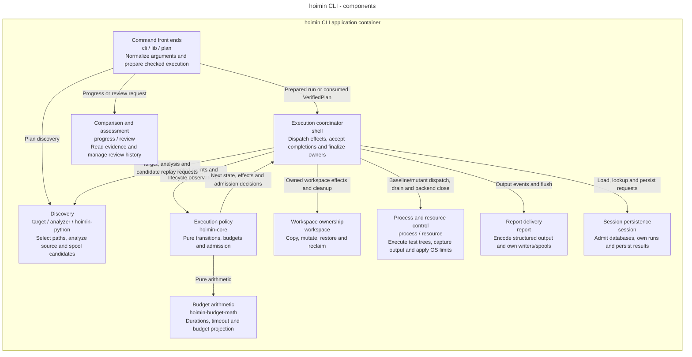
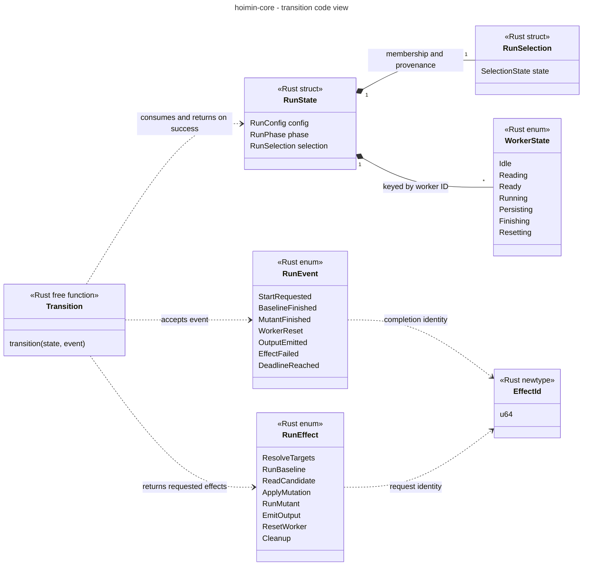
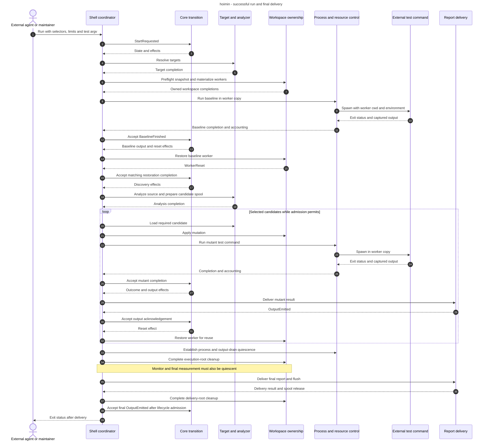

# hoimin through the C4 model

hoimin is a local mutation-testing CLI for external AI agents improving Python
tests. The agent selects a focused set of mutations, runs the project's test
command against worker copies, investigates survivors and compares later runs.
A human maintainer supplies requirements and reviews proposed test changes.
hoimin contains no LLM and does not edit tests or decide whether a survivor
justifies a new test.

This description was checked against implementation commit
[`d153ffb6`](https://github.com/HayaoSuzuki/hoimin/tree/d153ffb6896174b5515416b08c3a97b9745eb03a)
on 2026-10-23. It includes the structured-output simplification in #1104 and the
source-access, report-decoding and test-support boundary cleanup in #1105.
Source links below identify the owners of each responsibility; the diagrams
describe implemented boundaries rather than proposed language backends or services.

## How to read these views

The context view shows callers and external programs. The container view shows
one executable and its local stores. The component view divides responsibilities
inside that executable; the code view then focuses on the execution transition.
A dynamic view follows one successful run through final report delivery.

C4 uses **container** for an application or data store, including local files;
it does not mean a Docker container. Rust crates, Tokio tasks and worker-copy
slots belong inside the CLI application. These distinctions follow the official
[C4 container definition](https://c4model.com/abstractions/container) and
[component view](https://c4model.com/diagrams/component).

The Mermaid blocks are the editable diagram sources. Flowcharts use labelled
boxes and arrows to express C4 scopes; the code and dynamic views use class and
sequence notation. There is no separately maintained image or shared diagram
model. The documentation site links to this repository page rather than
publishing it with an embedded Mermaid renderer.

## Level 1: System context

Scope: hoimin as one software system. External programs can run on the same
machine; “external” refers to the implementation boundary.

The agent controls the improvement loop. hoimin supplies candidate identity,
execution evidence, saved assessments and progress comparisons. A survivor or a
saturation result does not prove equivalence or test completeness.

The test command is caller-supplied; Python with pytest is one possible
configuration. Candidate analysis uses Ruff's parser inside the Rust process.
Git participates only when the requested selection needs repository information.
Registries, release pipelines and hoimin's own CI are outside this runtime view.

Sources: [product principles](../product-principles.md),
[command dispatch](../../crates/hoimin-cli/src/lib.rs),
[Python analysis API](../../crates/hoimin-python/src/lib.rs),
[Git selection](../../crates/hoimin-cli/src/target/git.rs).

## Level 2: CLI application and local data

Scope: the executable, the external programs it starts, and logical stores on
one host. A store represents a portion of the filesystem or an embedded SQLite
database, not a server. Commands use different subsets of these stores.

Rectangles denote callers or applications; cylinders denote stores. Arrows name
operations initiated by their source. Reads return data without a second arrow.
All hoimin crates execute inside the CLI container:

| Crate | Responsibility | Internal crate dependencies |
| --- | --- | --- |
| `hoimin-cli` | CLI, source acquisition, scheduling, processes, storage and output | core, Python analysis, budget math |
| `hoimin-core` | Typed configuration, execution state, effects/events, budgets and report models | budget math |
| `hoimin-python` | In-process Python parsing, candidate generation and exception analysis | core |
| `hoimin-budget-math` | Duration types, automatic timeout and pure budget arithmetic | None |

The following graph shows compile-time crate dependencies. Each arrow points
from the dependent crate to its dependency; core has no dependency on the Python
analysis crate. Request/response arrows in the component view below describe
runtime collaboration and do not imply mutual Cargo dependencies.

The Python analysis crate uses core's shared vocabulary, including `ByteSpan`,
`MutationOperator` and mutation profiles. Core receives candidate data through
its effect/event types; it neither calls nor imports the analyzer implementation.

The CLI analyzer owns filesystem access and candidate spools. The analysis crate
accepts source through a Rust API and returns typed candidates and diagnostics;
JSONL spools do not form a service protocol between these crates.

Within the CLI, `source_file` owns capability-relative file access shared by
discovery, planning, review and workspace reads. Workspace operations adapt its
read-specific errors to workspace errors; source readers do not depend on worker
creation, mutation or cleanup state. Both paths reuse the same low-level opening
primitives, including the Windows handle-relative implementation.

The runtime creates reusable worker copies from a shared preflight snapshot.
Execution storage and delivery storage have separate cleanup conditions so a
report writer can retain its spool after execution resources become reclaimable.
Managed roots use leases, filesystem coordination and cleanup evidence; a
worker is a copy/slot, not another deployed application. Linux resource setup
can invoke a private launcher mode of the same executable.

Session persistence is optional for execution. Review storage belongs to the
assessment workflow and does not change verdicts, scores or candidate selection.
Saved plans and reports are exchange artifacts for focused local loops; the
application does not require a long-lived archive or an external database.

Sources: [workspace members](../../Cargo.toml),
[core dependencies](../../crates/hoimin-core/Cargo.toml),
[Python-analysis dependencies](../../crates/hoimin-python/Cargo.toml),
[binary entry point](../../crates/hoimin-cli/src/main.rs),
[workspace operations](../../crates/hoimin-cli/src/workspace/operation.rs),
[managed roots](../../crates/hoimin-cli/src/workspace/owned.rs),
[report delivery](../../crates/hoimin-cli/src/report/delivery.rs),
[session](../../crates/hoimin-cli/src/session/mod.rs),
[review](../../crates/hoimin-cli/src/review/mod.rs).

### Command and output boundaries

| Command | Main path | Result and persistent effects |
| --- | --- | --- |
| `run` | Normalize configuration → shell → core/effect handlers | JSON or JSONL execution report; baseline/mutant processes; optional session and metrics |
| `plan` | Targets and fingerprints → analyzer → candidate ranking | JSON plan; no baseline/mutant test execution |
| `verify` | Saved plan/current-input checks → `VerifiedPlan` → shell | JSON or JSONL execution report for selected candidates; configured persistence |
| `verify --dry-run` | Verification preparation → preview | One JSON preview in either accepted output mode; no baseline/mutant test execution |
| `progress` | Validated reports in caller-supplied chronological order → incremental comparison | JSON comparison, regression and multi-report saturation evidence; no test execution |
| `review list/show/record` | Plan/current sources and optional report → review store | JSON assessments/history; `record` appends with an expected revision |

`run` and `verify` accept `--format json|jsonl`. Progress and review each have one
JSON representation and no format flag. Help, actionable errors and captured
test output remain available. Shell-completion generation and human report
renderers have been removed.

Opt-in `RUST_LOG` tracing writes JSON Lines to stderr on both terminals and
redirected streams. Logging is off by default. The binary owns a diagnostics
thread with a bounded queue, whole-record dropping under pressure and a finite
shutdown wait. It has no terminal detection, periodic refresh or separate
progress snapshot. This tracing stream is distinct from execution reports and
from command errors or warnings, which can still use plain text.

Sources: [CLI definitions](../../crates/hoimin-cli/src/cli.rs),
[dispatch and errors](../../crates/hoimin-cli/src/lib.rs),
[report encoders](../../crates/hoimin-cli/src/report/mod.rs),
[binary tracing](../../crates/hoimin-cli/src/telemetry.rs),
[progress](../../crates/hoimin-cli/src/progress/mod.rs),
[review rendering](../../crates/hoimin-cli/src/review/render.rs).

## Level 3: Components inside the CLI

Scope: responsibilities inside the application container. Boxes group related
modules rather than reproduce the Rust import graph. Internal arrows denote
Rust calls, futures and typed values; they are not network connections.

The core decides execution policy without filesystem or process I/O. The shell
performs effects and admits their completions. A task finishing does not itself
acknowledge an effect: the coordinator first checks stop conditions, pending
identity and lifecycle admission. Process/output draining and filesystem
ownership remain shell responsibilities.

The workspace component keeps registered workers in one map whose slots are
active or pending cleanup. Owned blocking tasks retain the capabilities and
workspace state they need while detached from the async waiter. Shared
create/reset operations enforce the same copy and restoration policy for
synchronous and owned-task paths.

Discovery fixes root, operators, profile and candidate limits when constructing
the analyzer handler. It prepares reusable source/selection context and retains
candidate bodies in a spool; execution loads required candidates on demand.
Logical candidate-payload leases follow allocations through analysis and
conversion, including detached work. This payload budget does not bound the
entire source, parser AST or Rust process RSS.

Sources: [shell module contract](../../crates/hoimin-cli/src/shell.rs),
[core transition](../../crates/hoimin-core/src/machine.rs),
[analyzer acquisition](../../crates/hoimin-cli/src/analyzer/mod.rs),
[payload leases](../../crates/hoimin-python/src/analyzer/payload.rs),
[workspace handler](../../crates/hoimin-cli/src/workspace/mod.rs),
[owned operations](../../crates/hoimin-cli/src/workspace/operation.rs),
[process](../../crates/hoimin-cli/src/process/mod.rs),
[resource backends](../../crates/hoimin-cli/src/resource/mod.rs).

### Typed preparation and process requests

CLI normalization produces `RunConfig<EnvironmentRequest>`. Preparation captures
the requested environment and resolves fingerprint inputs into
`RunConfig<EnvironmentSnapshot>`. `DiscoveryConfig` keeps plan/verify analyzer
timeouts separate from execution limits and the resume fingerprint. Ordinary
`run` uses its total execution deadline for analysis.

Verification returns a `VerifiedPlan` that keeps checked configuration,
protected paths, selection and immutable provenance together. Its `execute`
method consumes that handoff and owned output writers. The shell does not accept
an independently attached, potentially inconsistent selection description.

`RunProcess<BaselineContext>` requires worker and run identity;
`RunProcess<MutantContext>` also requires mutant identity. A standalone
`RunProcess<ProbeContext>` carries neither. Effect variants fix those context
types. The process runner derives tracing context and output policy from that
identity rather than another editable purpose flag.

Sources: [configuration](../../crates/hoimin-core/src/config.rs),
[environment states](../../crates/hoimin-core/src/fingerprint_env.rs),
[checked plan](../../crates/hoimin-cli/src/plan.rs),
[selection/provenance](../../crates/hoimin-core/src/machine/selection.rs),
[process effects](../../crates/hoimin-core/src/effect.rs).

### File, artifact and database admission

Shared readers open plan/report artifacts as regular files. Streaming report
decoders check discriminators, event order, summary consistency and candidate
identity without first constructing an opaque JSON tree. Plan/report readers
accept the current schemas and reject unsupported versions without compatibility
adapters. Consumers retain different size and usability policies. Progress
processes adjacent reports and retains comparison metadata; review queries the
relevant history and borrows candidate descriptors for matching and output.

The shared decoder returns structurally validated data and neutral input errors.
Progress owns unusable-report classification and output errors. Review owns
project-path resolution and its complete-run/passing-baseline requirement.
Structural validation precedes those consumer checks.

Source and fingerprint reads use capability-relative roots and a byte budget
from the opened descriptor's length. The reader rejects growth or truncation
instead of following an indefinitely appending producer. Worker mutation reads
also check the manifest's expected size and content before changing permissions
or writing. Finite byte reads do not impose an I/O time bound or detect every
same-length concurrent rewrite. Verification's preliminary copy-membership check
examines paths; later preparation performs the required content checks.

Session admission checks the database identity/schema before enabling WAL or
initializing tables. It checks existing database and SQLite companion file link
counts before SQLite can touch them, rejecting shared hardlinks; companions
must also be regular non-symlink files. Foreign and unsupported databases are
rejected rather than migrated. Resume selects usable results from the current
schema under its own ownership policy.

Review uses a separate DELETE-journal database. It checks existing store files
and journal format before SQLite admission, and creates a new store privately
before publishing an initialized database. Revision checks and history updates
share a transaction. These checks protect normal local operation and accidental
path mistakes; they do not provide isolation against a hostile process replacing
paths concurrently.

Sources: [artifact readers](../../crates/hoimin-cli/src/artifacts/mod.rs),
[report decoding](../../crates/hoimin-cli/src/artifacts/run_report.rs),
[finite reads](../../crates/hoimin-cli/src/finite_file.rs),
[source-file primitives](../../crates/hoimin-cli/src/source_file.rs),
[portable source reader](../../crates/hoimin-cli/src/source_file/reader.rs),
[mutation writes](../../crates/hoimin-cli/src/workspace/mutation.rs),
[session admission](../../crates/hoimin-cli/src/session/schema.rs),
[review transactions/publication](../../crates/hoimin-cli/src/review/store.rs).

### Output, disk and shutdown ownership

JSON execution reports stream mutant records into a delivery spool and assemble
the final document from it. JSONL emits event records incrementally. The JSON
writer uses a fixed-size buffer for mutant serialization, so serialization does
not require an additional full-record byte vector. Candidate bodies, captured
output and consumer-side data still have their own memory costs.

`DiskLifecycle` owns admission for dispatch, cleanup and final acknowledgement.
The shell's `CleanupProgress` records attempts, including rejected attempts, and
cannot authorize removal. A shared immutable workspace manifest contains path,
size and digest metadata; sharing it does not grant cleanup authority or own a
copy reservation.

The first shutdown cause and absolute deadline remain fixed through draining
and finalization. A started blocking write, filesystem operation or backend
close can outlive the async wait; it must retain its resources. Run/verify report
work owns its writer and delivery-root leases. When safe removal cannot be
established, the shell defers reclamation and preserves incomplete-cleanup
evidence instead of treating a recovered task payload as successful completion.

Sources: [JSON spool](../../crates/hoimin-cli/src/report/json.rs),
[owned delivery](../../crates/hoimin-cli/src/report/delivery.rs),
[disk lifecycle](../../crates/hoimin-core/src/disk.rs),
[shared manifest](../../crates/hoimin-cli/src/workspace/manifest.rs),
[finalization](../../crates/hoimin-cli/src/shell/finalization.rs),
[shutdown contract](../development.md#shutdown-deadline-invariants).

## Level 4: Execution transition and owned state

Scope: selected types in `hoimin-core`. The diagram omits fields and enum
variants that do not explain this boundary. `Transition` denotes a free
function, not a Rust class; diamonds denote owned state, and dashed arrows denote
code dependencies.

The signature is
`transition(RunState, RunEvent) -> Result<(RunState, Vec<RunEffect>), MachineError>`.
Private state and pending-effect checks prevent a completion from advancing an
unrelated effect. `RunSelection` distinguishes all-candidate, explicit-ID and
ordered execution; ordered execution separates collection from dispatch.

Worker enum variants own the candidate or result required by their phase.
`MutationOutcome` distinguishes executed, reused and not-run evidence; status,
elapsed time and output availability derive from that evidence. For output
waits, the pending-effect entry also owns the continuation after acknowledgement.
Acknowledging mutant output releases the result and permits reset; process/task
ownership remains with the shell.

Sources: [state/transition](../../crates/hoimin-core/src/machine.rs),
[effects](../../crates/hoimin-core/src/effect.rs),
[events](../../crates/hoimin-core/src/event.rs),
[outcome evidence](../../crates/hoimin-core/src/resume.rs).

## Dynamic view: Successful execution and final delivery

Scope: an ordinary successful `run` with new mutant executions. The sequence
omits session operations, individual admission checks and intermediate output
events. Mutants can overlap across workers; the loop does not require global
serial execution.

The shell applies accepted completions to the core between the grouped steps.
Baseline output acknowledgement and worker restoration are separate events;
restoration must succeed before mutant dispatch. Ordered verification can
observe remaining budget after this reset, while explicit-ID verification skips
that budget observation.

The successful path removes execution storage before final report delivery,
then completes write/flush and delivery-root cleanup before accepting the final
output acknowledgement. Cancellation, fatal errors and expired waits follow
the fixed shutdown deadline and can leave deferred cleanup evidence.

Sources: [orchestration](../../crates/hoimin-cli/src/shell.rs),
[finalization](../../crates/hoimin-cli/src/shell/finalization.rs),
[report delivery](../../crates/hoimin-cli/src/report/delivery.rs).

## Deployment, trust and proof boundaries

All runtime components run on one host. Linux can enforce per-process-tree hard
limits through cgroup v2 when available; Windows uses Job Objects. The portable
backend, including macOS, requires the best-effort opt-in. Concurrent workers
create separate test process trees, so the selected backend and per-tree limits
must be considered alongside concurrency.

Worker copies separate hoimin's mutation writes from original sources. The
caller still trusts the project and its test command: copies are not a sandbox
for arbitrary code. Descendant memory limits do not cover Rust analyzer memory,
and cooperative disk monitoring does not provide a universal hard quota.
Captured output, report storage and external command side effects have separate
owners and limits. See the [resource contract](../usage.md#limits-and-defaults)
and [disk-safe execution](../usage.md#disk-safe-execution).

Creusot contracts cover the production arithmetic bodies in
`hoimin-budget-math`; they do not prove scheduling, wall-clock timing, SQLite,
serialization or cleanup. Lean models and implementation-oracle comparisons
cover selected state/lifecycle behavior with their own evidence limits. These
are development tools and artifacts, not runtime services. See
[production arithmetic proofs](../../formal/creusot/README.md) and
[Lean evidence limits](../knowledge/audits/lean-evidence.md).

Development adapters keep CLI configuration construction in
[CLI test support](../../crates/hoimin-cli/tests/support/exception_hierarchy_config.rs).
The shared Python oracle helper contains corpus data and expectations.
[Active allocation probes](../../crates/hoimin-cli/tests/support/workspace_metadata_probe.rs)
also belong to test support; historical maintenance probes remain archived
measurement evidence rather than compilation inputs for current tests.

## Maintaining these views

Update the command table and affected diagrams together when changing CLI
commands, crate responsibilities, persistent stores, effect/event identity,
resource admission or cleanup/output ordering. Keep implementation proposals out
of the runtime diagrams until their code exists. Source inspection supports
this description; it does not replace native-platform tests or establish new
performance measurements.

Use the [development guide](../development.md) for checks, the
[compatibility policy](../compatibility.md) for CLI/artifact changes, and the
[architecture concept](../knowledge/design/architecture.md) for historical
design evidence.
