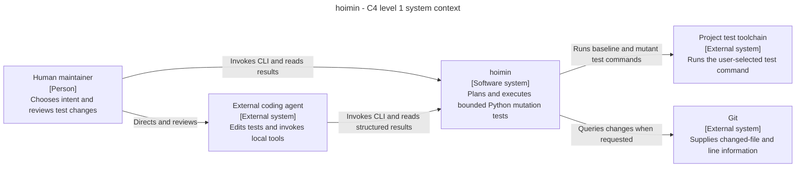
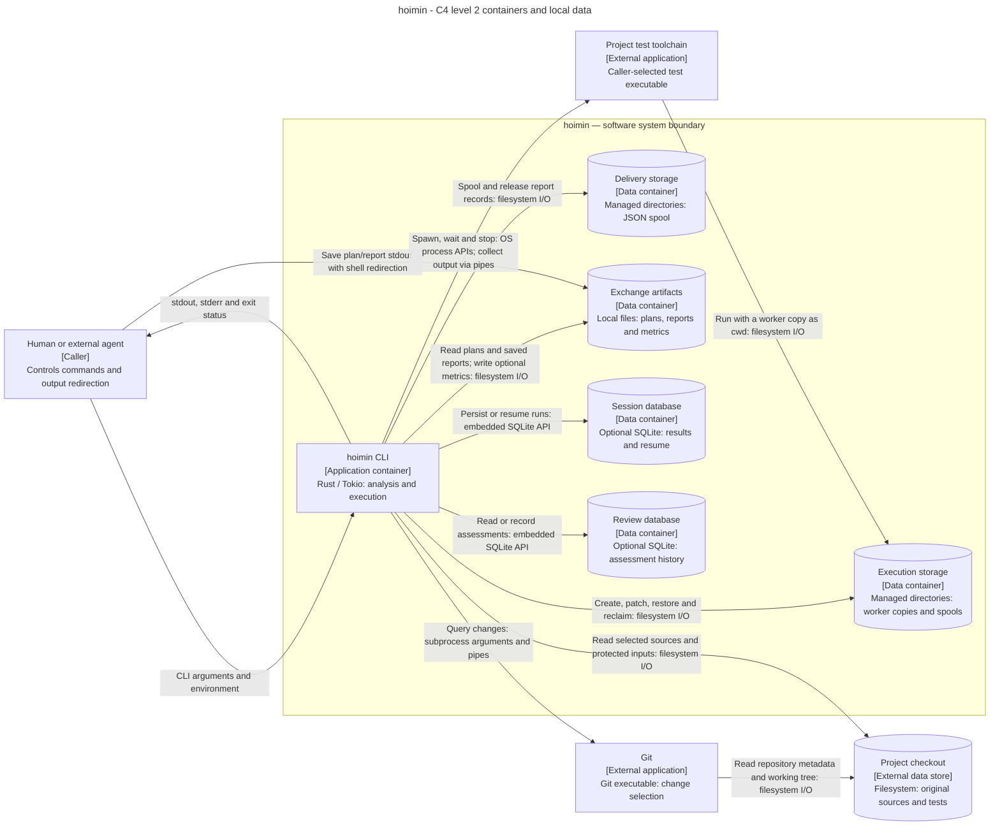
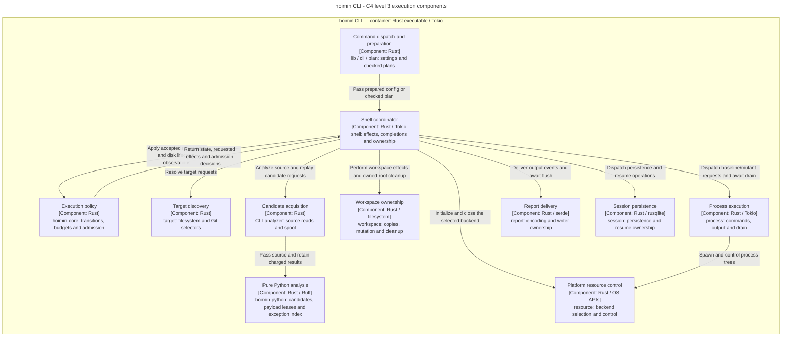
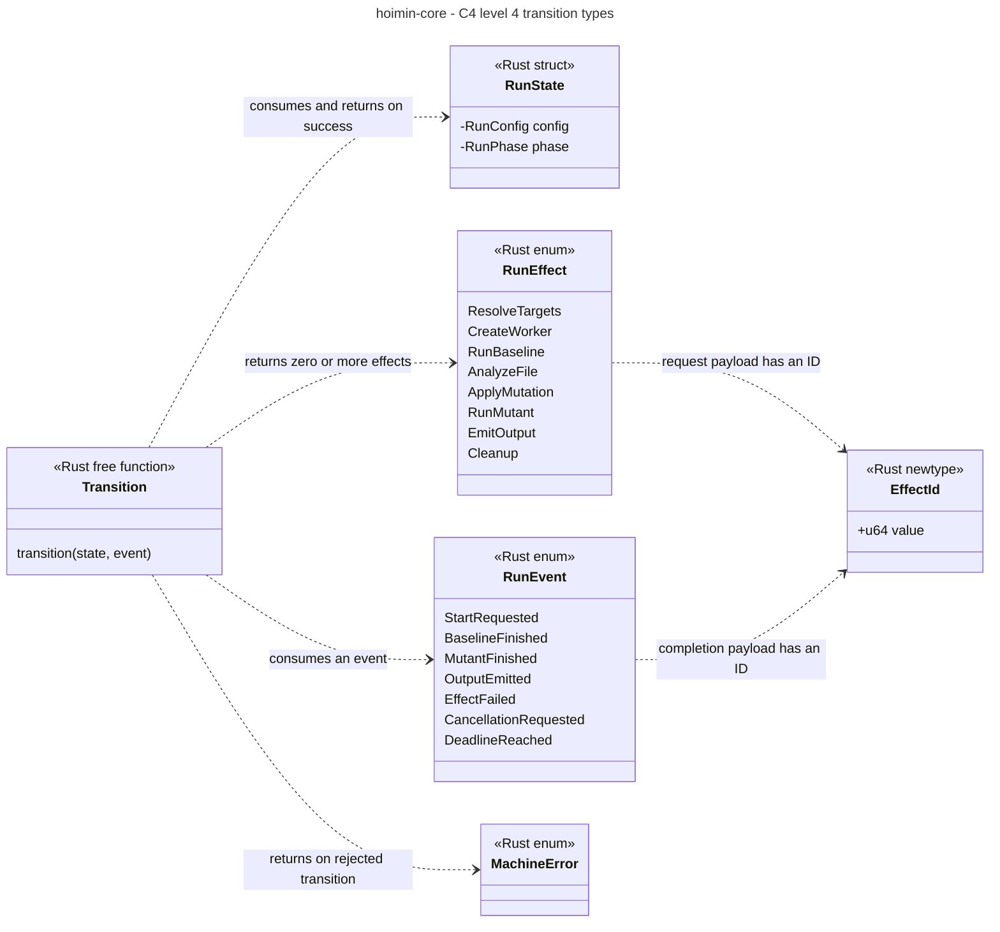
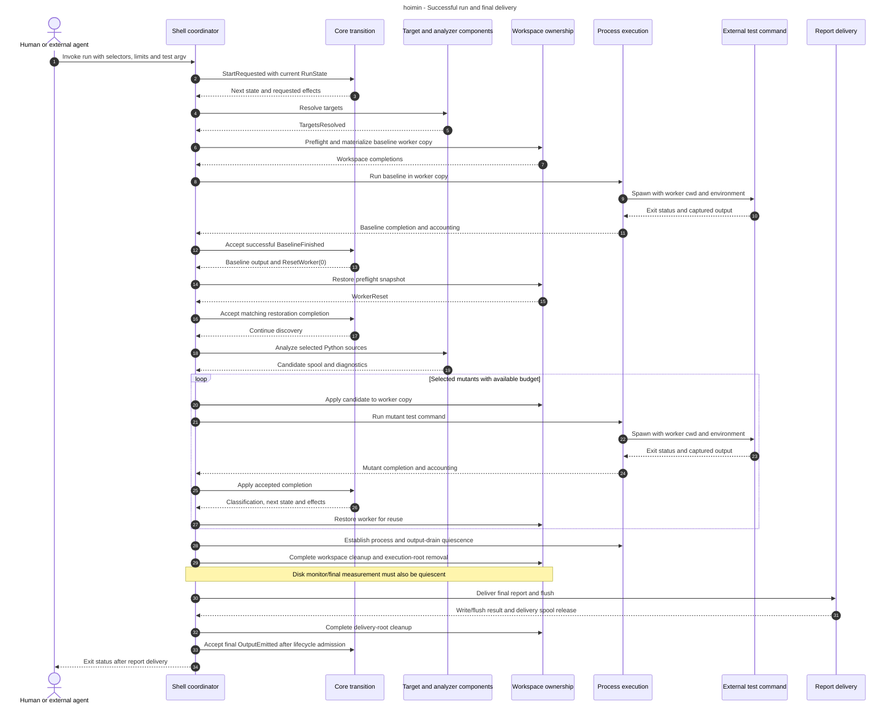

# hoimin through the C4 model

hoimin is a local mutation-testing tool for Python projects. A human or an
external coding agent selects code, inspects mutation candidates, runs a test
command against modified copies, and uses the results to improve tests. The
shipped application is one Rust executable; its core library and I/O handlers
run inside that executable.

This source-based description was checked on 2026-10-13 against
[`4e9f8ab7161cece688eecd6e50a0f16fbed3caec`](https://github.com/HayaoSuzuki/hoimin/tree/4e9f8ab7161cece688eecd6e50a0f16fbed3caec).
It describes the implemented architecture, not the proposed changes in issues
#743 or #849–#851. Links to source files identify the implementation to reread
when updating these views. No runtime or platform test result is implied.

## Reading and editing the views

Read levels 1 and 2 for the system boundary, level 3 for execution responsibilities,
and level 4 for the core transition API. The final sequence diagram explains how
those responsibilities cooperate during a successful run.

C4 distinguishes software systems, runtime/data containers, components inside a
container, and code. A **container** here means an application or data store;
Rust crates and Tokio tasks do not each become containers. See the official
[C4 container definition](https://c4model.com/abstractions/container) and
[diagram levels](https://c4model.com/diagrams).

The diagrams use ordinary Mermaid flowcharts, a class diagram and a sequence
diagram to express C4 views. C4 is [notation independent](https://c4model.com/diagrams/notation).
The [tooling guide](https://c4model.com/tooling) distinguishes drawing separate
views from generating views from a shared model: this document takes the former
approach, so repeated names and boundaries must be reviewed together. The
Mermaid blocks are the editable source; there are no separately maintained image
copies or a Structurizr model.

Open this Markdown file in a Mermaid-capable preview, or copy a fenced block
into a Mermaid renderer. The existing documentation site does not publish this
page directly; its development-guide link opens the repository source. Viewing
or editing the text does not require adding a runtime dependency to hoimin.

## Level 1 — System context

Scope: hoimin as one software system. Repository files and persistence are
expanded at level 2. The external agent is a caller, not an embedded LLM.

Legend: each box states its C4 type and responsibility. Arrows are directed,
labelled interactions, not a chronological sequence. External means outside
hoimin's implementation, even when the software runs on the same computer.

The project toolchain may be Python and pytest, but the command is supplied by
the caller. The Rust analyzer uses Ruff's parser in-process; it does not invoke
a Python/LibCST analyzer service. Git is needed for Git-based selection, not for
every run. Package registries, GitHub CI and the documentation website belong to
distribution and development workflows and are outside this runtime view.

Sources: [product direction](../product-principles.md),
[CLI dispatch](../../crates/hoimin-cli/src/lib.rs),
[Git selection](../../crates/hoimin-cli/src/target/git.rs),
[analyzer](../../crates/hoimin-cli/src/analyzer/mod.rs).

## Level 2 — Containers and local data

Scope: the CLI runtime and data it owns or consumes. Each store denotes a
logical portion of the local filesystem, not a server or a compulsory file for
every command. Session and review databases have distinct schemas and purposes.

Legend: rectangles are applications/callers, cylinders are data stores, and the
large boundary groups hoimin's application and logical stores. Arrows describe
operations initiated by their source; reads return data implicitly. They do not
assert that every command touches every store. `cwd` is a process's working
directory; JSONL is one JSON record per line; SQLite is embedded, not a database
server.

`hoimin-core`, `hoimin-python` and `hoimin-cli` are linked code in the CLI container. Tokio tasks,
blocking worker threads, the disk monitor and session dispatcher share that
process. The test command creates external process trees. Linux resource setup
can invoke a private launcher mode of the same executable; it is not an
additional long-running service.

Execution and delivery storage have separate ownership and cleanup conditions.
A worker is a reusable copy/slot, not an independently deployed worker service.
Reports normally go to stdout; the caller may save that stream as a file.
Metrics use a separately configured destination. Session persistence is opt-in;
human review storage does not alter mutation outcomes or scores.

Sources: [binary entry point](../../crates/hoimin-cli/src/main.rs),
[workspace members](../../Cargo.toml),
[shell roots and setup](../../crates/hoimin-cli/src/shell.rs),
[owned workspace storage](../../crates/hoimin-cli/src/workspace/owned.rs),
[report delivery](../../crates/hoimin-cli/src/report/delivery.rs),
[session](../../crates/hoimin-cli/src/session/mod.rs),
[review](../../crates/hoimin-cli/src/review/mod.rs),
[metrics destination](../../crates/hoimin-cli/src/metrics_destination.rs).

## Level 3 — Components of the CLI execution path

Scope: the `run` path and execution after `verify` preparation, inside the CLI
container. Boxes group cohesive Rust modules by responsibility. This is a
runtime collaboration view, not the complete Rust import graph. Internal
relationships use Rust calls, futures and typed values, not network protocols.

Legend: all boxes are in-process components. Arrows identify the main request or
result direction. Handler completions return to the shell; those return edges
are omitted except at the core boundary. Stores and external programs are shown
at level 2. The entry box groups command-front-end responsibilities for this
view; `plan` is not used by ordinary `run`.

The core decides what should happen next. It cannot start a process, write a
report or remove a directory. The shell performs those effects and decides when
a completion can be accepted. A finished task and an accepted core event are
separate facts. `DiskLifecycle` governs safe admission; `CleanupProgress` tracks
local cleanup attempts and cannot authorize removal.

The analyzer, target discovery and workspace use shared path/source policies
without moving filesystem I/O into core. Low-level readers and artifact
validation are omitted from this diagram to keep the execution boundary visible.

Sources: [pure transition](../../crates/hoimin-core/src/machine.rs),
[core dependencies](../../crates/hoimin-core/Cargo.toml),
[disk lifecycle](../../crates/hoimin-core/src/disk.rs),
[shell module contract](../../crates/hoimin-cli/src/shell.rs),
[target](../../crates/hoimin-cli/src/target/mod.rs),
[CLI analyzer acquisition](../../crates/hoimin-cli/src/analyzer/mod.rs),
[pure Python API](../../crates/hoimin-python/src/lib.rs),
[workspace](../../crates/hoimin-cli/src/workspace/mod.rs),
[process](../../crates/hoimin-cli/src/process/mod.rs),
[resource](../../crates/hoimin-cli/src/resource/mod.rs),
[report](../../crates/hoimin-cli/src/report/mod.rs),
[session dispatcher](../../crates/hoimin-cli/src/session/mod.rs).

### Command paths outside the execution loop

These are branches of the same CLI application, not additional containers.

| Command | Main path | Test processes / persistent effects |
| --- | --- | --- |
| `run` | CLI config → shell → core/effect handlers | Runs baseline and mutants; optional session and metrics |
| `plan` | `plan::create` → target discovery → `hoimin-python` analysis → ranking | Writes a plan to stdout; does not run baseline/mutant tests |
| `verify` | `prepare_verify_selection` → `VerifiedPlan` → shell | Rechecks plan/current inputs, then executes the selected candidates |
| `verify --dry-run` | Checked plan → preview | Writes a preview without baseline/mutant execution |
| `progress` | Validated saved reports → comparison → rendering | Reads reports; no mutation test execution |
| `review list/show/record` | Plan, optional report and current source identity → review store | Reads assessments or records revisioned assessments separately from run results |
| `completions` | CLI definitions → completion script writer | Writes a shell completion script |

Shared [artifact readers](../../crates/hoimin-cli/src/artifacts/mod.rs) own bounded
reads and report decoding; individual commands retain their acceptance rules.
See [dispatch](../../crates/hoimin-cli/src/lib.rs),
[plan and VerifiedPlan](../../crates/hoimin-cli/src/plan.rs),
[progress](../../crates/hoimin-cli/src/progress/mod.rs), and
[review](../../crates/hoimin-cli/src/review/mod.rs).

## Level 4 — Selected code inside execution policy

Scope: a small code view of `hoimin-core::transition`, rather than an exhaustive
class diagram. Rust structs and enums are represented as UML-style classes.
`Transition` represents a free function, not a class in the implementation.
Only selected fields and enum variants are shown; variant payloads are omitted.

Legend: dashed arrows are code dependencies, not temporal messages. `EffectId`
is a tuple newtype; `value` is a display label for its `u64` field. Completion
events identify an effect, while stop/start events do not all carry effect IDs.
The actual signature is
`transition(RunState, RunEvent) -> Result<(RunState, Vec<RunEffect>), MachineError>`.

`RunState` keeps execution state private. Effects describe operations; handlers
perform them. The transition checks whether a completion belongs to a pending
effect and is valid for the current state. This code boundary supports tests
without requiring every state transition to start an OS process.

Sources: [RunState, transition and MachineError](../../crates/hoimin-core/src/machine.rs),
[RunEffect and EffectId](../../crates/hoimin-core/src/effect.rs),
[RunEvent](../../crates/hoimin-core/src/event.rs).

## Dynamic view — Successful run and final delivery

Scope: a successful ordinary run with a new mutant execution. This is an
abbreviated collaboration sequence; it omits report-start events, session
operations, candidate ranking, budget checks and repeated integrity checks.
Completions between the grouped steps are accepted by the shell and applied to
core. Mutant work may overlap across workers within the configured limits.

Legend: solid arrows are requests, dashed arrows are results, and the loop groups
repeated work rather than requiring serial execution of all workers. Workspace
ownership includes managed-root cleanup invoked by the shell. This sequence
does not substitute for the state machine or enumerate every event.

Baseline output acknowledgement is independent of restoration. Only the accepted
worker reset permits discovery or the budget check for ordered verification.
Explicit candidate-ID verification skips this budget observation. Cancellation
or failure during restoration prevents mutant dispatch.

On cancellation, timeout or fatal failure, the first shutdown cause and absolute
deadline stay fixed through draining and outer finalization. Recovering a queued
ownership payload after expiry does not certify successful core completion.
Already-running blocking work can outlive its async wait. Run and verify report
work requires owned writers and retains its writer and delivery-root ownership. Unsafe removal can be deferred for later managed-root
reclamation, and failures preserve incomplete-cleanup evidence.

Sources: [shell orchestration and finalization](../../crates/hoimin-cli/src/shell.rs),
[owned report delivery](../../crates/hoimin-cli/src/report/delivery.rs),
[shutdown deadline contract](../development.md#shutdown-deadline-invariants).

## Deployment and evidence limits

The runtime shown above is local to one host. OS backends differ: Linux can use
cgroup v2 hard limits when available; Windows uses Job Objects; portable
best-effort operation requires the corresponding opt-in. macOS uses the portable
path. The selected backend and reported mode matter more than the operating
system name alone. See [resource implementation](../../crates/hoimin-cli/src/resource/mod.rs)
and [limits and defaults](../usage.md#limits-and-defaults).

Worker copies isolate hoimin's mutation writes from the original source. They
are not a security sandbox for arbitrary test commands. Descendant-process
memory limits do not cover the in-process Rust analyzer, and cooperative disk
monitoring is not a universal hard quota. Persistent outputs and test-command
side effects remain separate concerns. See [product constraints](../product-principles.md)
and [disk-safe execution](../usage.md#disk-safe-execution).

Lean models and their Rust adapters are development evidence, not services or
containers in this runtime. Model proofs and selected implementation comparisons
have different scopes; see [Lean evidence limits](../knowledge/audits/lean-evidence.md).

## Keeping this description current

Update the affected views together when changing CLI dispatch, process/storage
boundaries, the effect/event protocol, plan execution ownership, resource
backends, or cleanup/report ordering. Recheck the command table when adding a
subcommand. Do not promote a proposal to an implemented component before its
code exists.

The [architecture concept](../knowledge/design/architecture.md) links this view
to historical design evidence. Use the [development guide](../development.md)
for validation procedures and the [compatibility policy](../compatibility.md)
for changes to CLI and saved artifacts. The C4 diagrams describe responsibilities
and relationships; they do not prove termination, isolation or platform support.

## Process request identity

The core fixes required identity when it creates an effect:
`RunBaseline(RunProcess<BaselineContext>)` requires worker and run ID;
`RunMutant(RunProcess<MutantContext>)` also requires mutant ID. A standalone
`RunProcess<ProbeContext>` carries no workspace identity. Purpose is not stored
as another independently editable flag inside these requests.

The shell builds the worker environment from that typed identity before the
shared runner consumes the command. The runner lowers to one private context
enum for tracing, completion worker tags and mutant output policy; it does not
infer purpose from missing metadata. Cancellation gates, process ownership and
metrics admission retain their existing ordering. See
[typed process requests](../development.md#typed-process-execution-requests)
for the environment convention.
